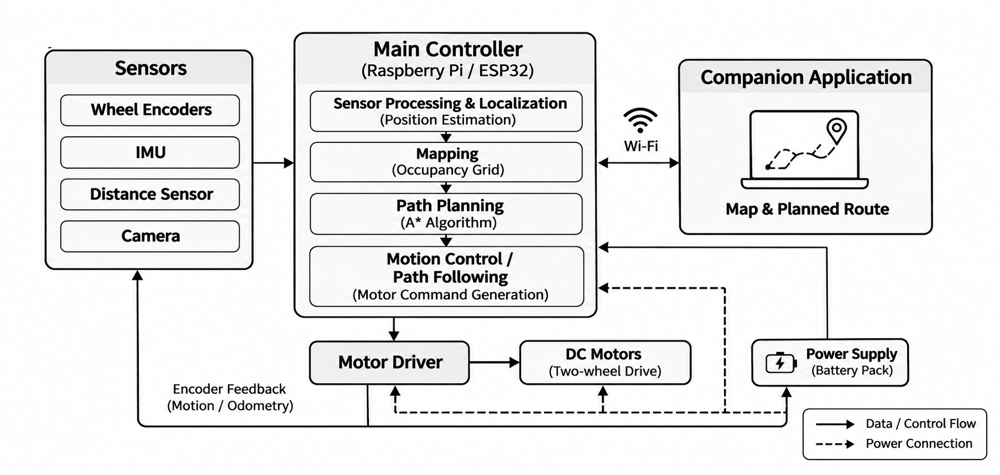
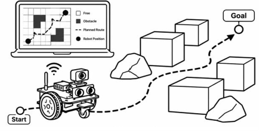

# SENTRA

### Sensor-Based Autonomous Exploration and Mapping

SENTRA is an autonomous mobile robotics project designed to explore unknown indoor environments, detect obstacles, generate occupancy grid maps, and plan collision-free navigation paths.

The project investigates sensor-based navigation in simulated post-disaster environments through the integration of embedded systems, robotics, localization, mapping, and autonomous path planning.

Developed as part of the EEE309 Software–Hardware Integration course at Kadir Has University.

**Project Status:** Under Active Development

---

## Project Objectives

- Autonomous exploration of unknown indoor environments.
- Real-time obstacle detection and avoidance.
- Robot pose estimation using wheel encoders and IMU measurements.
- Generation of a 2D occupancy grid map.
- Autonomous path planning using the A* algorithm.
- Motion control for planned path execution.
- Wireless transmission of mapping and navigation data.
- Experimental evaluation of system performance.

---

## System Architecture

<p align="center">
  
</p>

The proposed system architecture consists of five main components:

- Sensor and perception system
- Localization and mapping
- Path planning and autonomous navigation
- Motor control and actuation
- Wireless communication and companion application

The architecture represents the intended system design and is subject to revision throughout development and testing.

---

## Exploration Concept

<p align="center">
  
</p>

SENTRA aims to explore an unknown environment while identifying obstacles and constructing a representation of its surroundings.

The generated occupancy grid will distinguish between free, occupied, and unexplored areas. The robot will use this information to support navigation and path planning between selected locations.

---

## Software Development

SENTRA builds upon the initial robotics simulation framework developed in the ARES project.

The inherited codebase provides a foundation for reactive navigation, finite state machine logic, distance sensing, motor control, and basic grid representation.

The software is being reorganized into independent modules to improve maintainability, testability, and hardware–software integration.

### Current Development Status

- [x] Initial simulation framework
- [x] Baseline finite state machine
- [x] Predefined distance data handling
- [x] Basic motor action abstraction
- [x] Basic expandable grid representation
- [x] State machine modularization
- [ ] Complete modular software architecture
- [ ] Virtual environment and sensor simulation
- [ ] Differential drive motion model
- [ ] Encoder-based odometry
- [ ] IMU-assisted localization
- [ ] Sensor-based occupancy grid mapping
- [ ] A* path planning
- [ ] Path following and replanning
- [ ] Safety and mission management
- [ ] Wireless communication
- [ ] Companion application
- [ ] Hardware integration and validation

---

## Hardware Architecture

| Component | Purpose |
|---|---|
| Main Controller | Embedded processing and system coordination |
| HC-SR04 | Distance measurement and obstacle detection |
| SG90 Servo | Angular distance scanning |
| Wheel Encoders | Wheel motion measurement and odometry |
| IMU | Orientation estimation |
| DC Motors | Differential drive locomotion |
| L298N | Motor control |
| 2WD Chassis + Caster | Mobile robot platform |
| Camera | Additional visual context |
| Power Supply | System power distribution |

The final hardware configuration will be determined through component selection, calibration, and experimental testing.

---

## Repository Structure

```text
SENTRA/
├── docs/
│   ├── architecture/
│   ├── diagrams/
│   └── reports/
├── firmware/
├── include/
├── simulation/
├── src/
├── tests/
├── visualization/
├── .gitignore
├── LICENSE
└── README.md
```

| Directory | Description |
|---|---|
| docs/ | Technical documentation, architecture diagrams and project reports |
| firmware/ | Embedded software and hardware integration |
| include/ | C++ header files |
| simulation/ | Virtual environment and robot simulation |
| src/ | Core C++ software modules |
| tests/ | Software and system validation |
| visualization/ | Mapping, navigation and sensor data visualization |

The repository structure is being established progressively as individual modules are developed.

---

## Development Roadmap

| Phase | Description | Status |
|---|---|---|
| Phase A | Project foundation and modular architecture | In Progress |
| Phase B | Virtual environment and robot simulation | Planned |
| Phase C | Sensor integration and calibration | Planned |
| Phase D | Localization and occupancy grid mapping | Planned |
| Phase E | Path planning and motion control | Planned |
| Phase F | Communication and visualization | Planned |
| Phase G | System integration and experimental validation | Planned |

---

## Build and Run

The current simulation is implemented in C++ and requires a compiler with C++17 support.

From the repository root, compile the source files:

```bash
g++ -std=c++17 -Iinclude src/*.cpp -o sentra.exe
```

On Windows, run the simulation:

```powershell
.\sentra.exe
```

The current simulation uses predefined sensor measurements and console-based motor actions. A virtual environment and physical robot model will be introduced in subsequent development phases.

---

## Testing and Validation

The system will be evaluated through controlled experiments focusing on:

- Obstacle detection accuracy
- Localization and odometry error
- Mapping accuracy
- Navigation success rate
- Collision avoidance performance
- Path execution accuracy
- Communication latency
- System reliability and repeatability

Experiments will be conducted in controlled indoor environments rather than actual disaster sites.

---

## Project Documentation

- [Project Proposal](docs/reports/SENTRA_Project_Proposal.pdf)
- [System Architecture](docs/diagrams/system_architecture.png)
- [Exploration Concept](docs/diagrams/exploration_concept.png)
- [Architecture Documentation](docs/architecture/)

---

## Technical Domains

- Embedded Systems
- Autonomous Robotics
- Sensor Fusion
- Localization and Odometry
- Occupancy Grid Mapping
- Differential Drive Kinematics
- Path Planning
- Finite State Machines
- Hardware–Software Integration
- C++

---

## Academic Context

**University:** Kadir Has University

**Course:** EEE309 — Software–Hardware Integration

**Project:** SENTRA — Sensor-Based Autonomous Exploration and Mapping

---

## Acknowledgments

The initial simulation framework is derived from the ARES robotics project and is being adapted and extended to meet SENTRA's system requirements.

---

## License

See the [LICENSE](LICENSE) file for licensing information.
